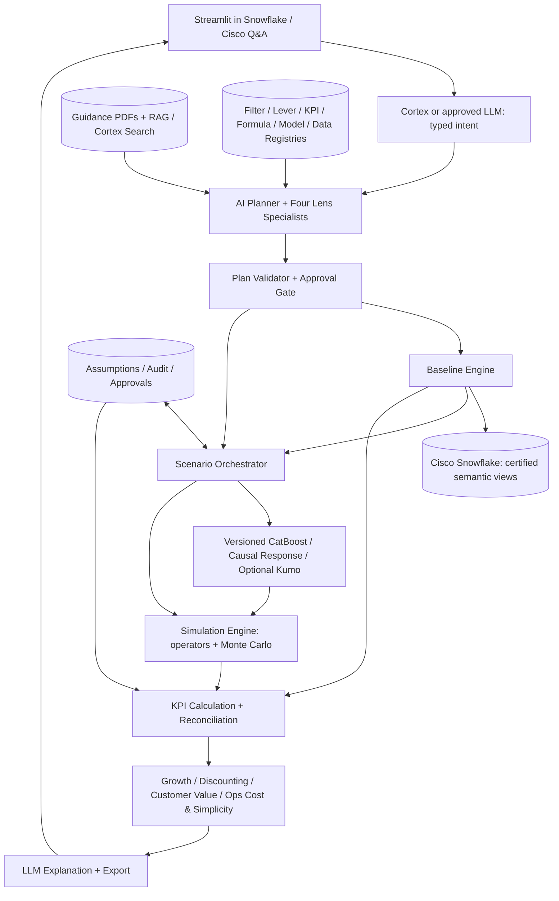
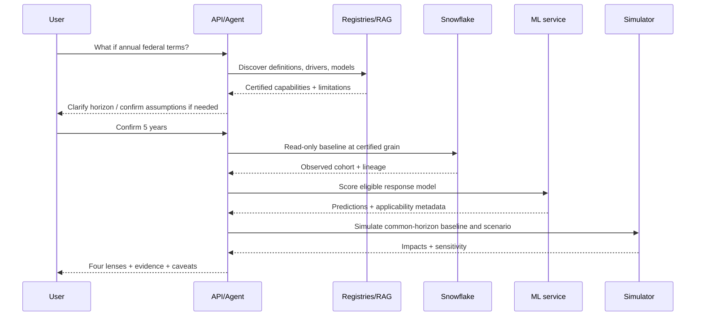
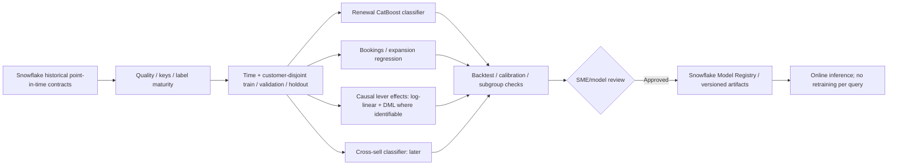

# Cisco EA What-If Intelligence Engine — Technical Architecture & Design

**Version:** 0.2 | **Updated:** 20 November 2026 | **Status:** Proposed technical design / pending Cisco approval

## 1. Architecture principles

1. **Dynamic questions, bounded capabilities:** any business-language prompt may be interpreted, but numeric outcomes require registered supported mechanics and evidence; unknown mechanics do not trigger arbitrary code generation.
2. **Four lenses in the latest deck:** Growth; Discounting; Customer Value; Ops Cost & Simplicity. Margin is excluded. Earlier four-lens documents are superseded on this point pending Cisco sign-off.
3. **LLM selects, registries authorize:** LLM emits typed intent and selects relevant pre-approved filters, levers, KPI definitions, formulas, source views and models. It must not make up authoritative lever ranges, generate executable financial rules or bypass policy gates.
4. **One planner, four logical lens specialists:** 19-Nov deck's topology can be implemented as one planner plus four light lens-specific prompts/routing configurations for POC; separate agents are an optional physical implementation, not mandatory.
5. **Baseline first:** Snowflake historical observed metrics versus future no-change forecast must be explicit. A fair comparison uses identical cohort, horizon, FX, grain and assumptions.
6. **Train targets, not scenarios:** renewal propensity, bookings/expansion, causal lever response, cross-sell. Monte Carlo is a simulation component, not a fifth trained predictive target.
7. **Separate economic mechanics from KPIs:** Simulation Engine applies interventions, prediction, finance rules and uncertainty; KPI Engine applies metric definitions and compares outcomes; lens layer presents those KPIs.
8. **Causal humility:** log-linear elasticities and CatBoost SHAP explain historical associations unless causal assumptions have been validated; treatment selection bias matters. Monotonicity only where defensible.
9. **Snowflake-native, runtime-specific:** SQL/Snowpark for data/aggregations; ML Jobs/Model Registry for target-specific training and serving; Container Services for approved custom packages/heavy Monte Carlo; Cortex Search/LLM and Streamlit only where enabled in Cisco account.
10. **Traceability and abstention:** model/rule/data versions, ranges, provenance, uncertainty, business-owner approvals and meaningful `insufficient_evidence` are mandatory.

## 2. Logical component diagram



**Logical vs physical:** Diagram shows logical ownership, not mandatory microservices or four separately hosted agents. Suggested deployment is Snowflake-native where permissions permit: SQL/Snowpark, Model Registry/ML Jobs, Container Services, Cortex Search/AI and Streamlit. Existing FastAPI or external Cisco Q&A API can remain as an adapter where enterprise integration requires it. No specific Cisco service permission is yet confirmed.

## 3. Data plane and control plane

**Data plane:** read-only Snowflake semantic views → point-in-time feature/label tables → historical baseline or no-change forecast → selected target-specific models + approved simulation operators → KPI aggregation → four lenses. Do not move entire raw production tables into UI memory.

**Control plane:** question schemas, registry versions, lever-to-KPI dependency edges, Finance-approved formula book, model approvals, assumptions book, RAG policies, query execution policy, cost controls, audit and drift monitors.

**Ownership:** the **Baseline Engine** owns reference calculation and cohort selection; the **Simulation Engine** owns lever changes, model invocation, cash-flow/event transformations and Monte Carlo; the **KPI Engine** owns canonical metric definitions, scenario/baseline deltas and reconcilable aggregation; the **Lens Layer** groups KPIs and flags incomplete evidence. Shared reviewed formula operators are permitted; independent duplicated formulas are not.

### Suggested Snowflake logical objects (names illustrative)

| Object | Grain | Purpose |
|---|---|---|
| `EA_SEMANTIC.BOOKINGS` | Agreement × suite × booking/period | Certified bookings, term, discount, term dates. |
| `EA_SEMANTIC.RENEWAL_EVENTS` | Renewal opportunity | Matured labels; renewal/censoring definitions. |
| `EA_SEMANTIC.CUSTOMER` | Customer | Segment, federal, theatre, governed IDs. |
| `EA_SEMANTIC.CONSUMPTION` | Subscription × time | Adoption, install base, allowance/TF where available. |
| `EA_SEMANTIC.DEAL_OPERATIONS` | Event | Amendments, approvals, billing events and cost inputs where available. |
| `EA_FEATURES.CONTRACT_TERM_SNAPSHOT` | Customer × agreement × suite × term × as-of | Candidate ML training grain; verify uniqueness. |
| `EA_GOV.FILTER_REGISTRY` | Filter/version | Typed filter columns, values, scope and permissions. |
| `EA_GOV.LEVER_REGISTRY` | Lever/version | Default, allowed/observed/model-supported range, policies. |
| `EA_GOV.KPI_REGISTRY` | KPI/version | Formula and metric units, grain, source and owner. |
| `EA_GOV.FORMULA_REGISTRY` | Formula/version | Approved executable deterministic operators and references. |
| `EA_GOV.LEVER_KPI_MAP` | Lever × KPI × version | Causal/associational/derived edges and compatible model/operator. |
| `EA_GOV.MODEL_REGISTRY` | Target/model/version | Features, label definition, calibration, supported intervention region, approval. |
| `EA_GOV.DATA_REGISTRY` | Source/version | Allowed semantic objects, lineage, data gaps. |
| `EA_GOV.GUIDANCE_RULES` | Rule/version/effective date | SME-reviewed policies parsed from guidance. |
| `EA_AUDIT.RUNS` | Run ID | Request, plan, data cut, code/rule/model versions, results. |

The known raw source example `CPS_DB.CPS_CPSBIAPOC_WI.EA_ALC_BOOKINGS_POSTOA_FINANCE_DATA` must be validated; none of the logical objects above are asserted to exist today.

## 4. Interfaces and contracts

### 4.1 `POST /v1/whatif/plan`

Input:
```json
{"question":"What if federal EA terms move from 3 to 1 year?","scope":{"theatre":null},"user_context":{"role":"analyst"}}
```

Output (illustrative):
```json
{
 "plan_id":"uuid", "intent":"what_if", "entity":"EA",
 "population":{"segment":"Federal"},
 "interventions":[{"driver":"contract_term_years","from":3,"to":1}],
 "horizon_years":null,
 "metrics":["bookings","renewal_rate","ops_cost"],
 "steps":["resolve_population","query_baseline","score_response","simulate","validate"],
 "missing_inputs":["horizon_years"], "status":"clarification_required"
}
```

### 4.2 `POST /v1/whatif/runs`

Input: validated `plan_id`, optional signed assumption overrides and execution budget. Response: `run_id`, `status`, baseline, scenario metrics, provenance and warnings. For long runs, return asynchronous status endpoint rather than block UI.

### 4.3 Model registry entry

```yaml
id: term_bookings_v1
kind: catboost_regressor
predicts: annualized_bookings_usd
required_features: [suite, segment, historical_bookings, term_years]
valid_term_years: [1, 3, 5]
training_cutoff: null
approval_status: experimental
artifact_uri: null
calibration_status: not_validated
```

Do not register this example as approved until feature definitions, artifacts and evaluation are confirmed.

### 4.4 Operator contract

```python
class Operator:
    name: str
    input_schema: dict
    output_schema: dict
    def execute(self, inputs: dict, context: dict) -> dict: ...
```

Operators should include `aggregate_baseline`, `normalize_annualized_value`, `discount_cashflows`, `estimate_renewal_workload`, `compare_scenarios`, `monte_carlo`, `sensitivity` and `breakeven`. Each must define units, horizon, allowed assumptions, provenance and deterministic tests.

## 5. Orchestration sequence



## 6. Training architecture (separate from inference)



| Capability | Target and modeling approach | First-phase status |
|---|---|---|
| Renewal propensity | Matured renewed/not-renewed label; CatBoost classifier; calibrated probabilities and censoring-aware evaluation | Priority **if label coverage supports** |
| Future bookings / expansion | Clearly defined next-term amounts; CatBoost regressor; test Tweedie **versus** other losses and optionally split expansion and total bookings | Priority **if complete target** |
| Lever elasticity / intervention response | Log-linear interpretable associations plus causal methods (e.g., Double ML) **only with overlap and credible adjustment for confounding** | Discovery/experiment; may not be validated by 11-Dec |
| Cross-sell | New suite acquisition within agreed horizon, target population and historical product breadth | Later unless labels ready |
| Monte Carlo | Repeated simulation draws using calibrated uncertainty, correlations and reproducible seeds | Simulation service, **not** trained model |

**Candidate grain:** customer × agreement × suite × contract term; model-specific grain may differ. Define mature labels, time splits, and features available at prediction timestamp. Candidate features include install-base coverage, tier, term, programmatic/non-standard discount, TF flag, growth allowance quantity, payment frequency, value shift, suite, segment/federal flag and prior consumption. Confirm actual data availability before relying on any feature.

**Model validation:** classification PR-AUC/ROC-AUC and calibration; regression MAE/WAPE or agreed financial error; time-held-out results and cohort bias; compare against baselines. Beware that discount/free quantity can be selectively granted to already-at-risk deals. CatBoost monotone constraints are optional per-feature assumptions after SME and empirical review; they do not transform prediction into causal estimates.

**Serving:** register approved model versions and feature contract; reuse one model across many questions sharing a target. New outcome targets or unsupported mechanisms may require new development. Schedule monitoring/retraining with gated model promotion, not training at question time.

## 7. Baseline and counterfactual design

- **Historical observed baseline:** read-only source records aggregated using the KPI Registry for the exact permitted cohort, period, currency, entity grain and metric definition. A row-level bookings fact may need deduplication before `SUM(ANNUALIZED_NET_PRICE_USD_AMT)`.
- **Future no-change baseline:** forecast the unchanged policy/portfolio through the same execution path used for the altered scenario; disclose predicted rather than observed status.
- **Scenario:** apply selected lever changes and policy checks, use supported intervention-response models and/or bounded assumptions; ensure baseline and scenario share horizon and unaffected assumptions.
- **Simulation Engine:** apply approved contract mechanics, term/discount transforms, model predictions, renewal events, NPV and optional calibrated Monte Carlo; avoid applying discount or elasticity twice when model target already includes effects.
- **KPI Engine:** canonical numeric definitions, denominators, aggregation, unit/FX normalization and absolute/percentage scenario deltas; lens UI only displays these values.
- **Four lenses:** Growth = bookings/land/expand/renew; Discounting = programmatic/non-standard discounts, protection/credits; Customer Value = adoption/consumption, product breadth, renewal health; Ops Cost & Simplicity = approvals, amendments, renewal and billing events. Clearly show unavailable metrics until approved views exist. Margin excluded.
- **Uncertainty:** calibrated P10/P50/P90 portfolio distributions only after validating conditional uncertainty and shared shocks/correlations; simple Monte Carlo draw count does not establish coverage. SHAP is predictive attribution, not lever causation.

## 8. LLM safety and validation

- Use structured outputs (Pydantic/JSON Schema) for intent and plan; allow only registered metrics, drivers, operators and source views.
- Restrict SQL to parameterized, read-only, allowlisted query templates or AST-validated SELECTs; enforce limits and cost budgets.
- Treat retrieved PDFs, metadata and user questions as untrusted content; never execute instructions embedded in documents.
- No arbitrary Python generated by LLM, no unrestricted SQL, no model artifact selection outside registry.
- Verify plan DAG dependencies, compatible units, metric grain, time horizon, evidence coverage and intervention support before execution.
- Unsupported mechanism → `unsupported` with missing capabilities; incomplete data → `insufficient_evidence`; ambiguous question → `clarification_required`.

## 9. Knowledge retrieval

Index Cisco-approved policies, SOPs, EA programs, data dictionary and SME decisions with document ID, version, owner, effective date and access scope. Retrieve definitions/rules to help plan and explain. Structured numeric facts should come from Snowflake queries, not embeddings. Citation/version references must appear in the audit record.

## 10. Model evaluation and governance

| Dimension | Minimum validation |
|---|---|
| Question interpretation | Gold set of paraphrases, unseen compositions, ambiguous inputs and false positives. |
| Data | FK/grain checks, nulls, fiscal semantics, reconciliation to reported bookings. |
| ML | Temporal holdout, MAE/WAPE for amounts; PR-AUC/calibration for renewal/churn as appropriate. |
| Causality | Overlap, confounding, intervention support and documented assumptions. |
| Simulation | Golden numerical tests, invariants, sensitivity monotonicity where expected, deterministic seed. |
| Ranges | Coverage and dependency checks; P10/P50/P90 clearly defined. |
| Security | RBAC, injection, query allowlist, data exfiltration and tenant controls. |
| Scale | Live query plan and latency on realistic production-scale slices. |

## 11. Deployment and operations

**Target environment:** Cisco Snowflake-centric execution **subject to access and approved runtime**. SQL/Snowpark for baseline, joins, feature tables and lightweight deterministic metrics. Snowflake ML Jobs / suitable training runtime for Python CatBoost. Snowflake Model Registry for approved model versions. Snowpark Container Services for custom EconML dependencies, heavy simulation, optional GPUs and persistent services where needed. Cortex AI/Search and Streamlit in Snowflake are options pending regional and account approvals. A separate API adapter is permissible for enterprise Q&A integration.

**Kumo:** NVIDIA Kumo Relational is an optional benchmarking candidate for multiple relational prediction tasks. It is **not selected** as the production model and does not replace causal estimates, approved formulas, planner or Simulation Engine; verify exact product, GPU/runtime, security, cost and licensing before a trial.

**CI/CD:** source-controlled SQL/Python, environment-specific permissions, dependency locks, golden calculator tests, signed registry changes, time-split model evaluations, data-quality checks and regression tests. Use dev/test with approved synthetic/masked data; production read-only for source queries.

**Operations:** latency/cost budgets, data freshness and feature drift, calibration/backtests, model promotion gates, audit retention, prompt injection defenses, role-based filtering and incident rollback. Scheduled monitoring can be monthly; retraining is conditional on evidence and approval.

## 12. POC-to-product migration

| Existing demo element | Migration |
|---|---|
| `term_deals.csv` / Parquet | Synthetic-only local demo; replace with certified Snowflake semantic views. |
| CatBoost point/P10/P90 models | Register artifacts; validate temporal performance, counterfactual support and interval calibration. |
| Hardcoded adoption/five-year share | Represent as configurable driver/assumption definitions, not mandatory user inputs. |
| Fixed 3-year baseline | Replace with certified observed portfolio baseline and user-approved comparator. |
| Renewal points and coverage volatility | Keep as clearly marked proxies until actual operations data/models exist. |
| Streamlit | Retain as POC shell; production API into Cisco interface. |

## 13. Incremental milestones and risks

| Phase | Indicative window from 23-Nov ready start | Key deliverables / acceptance |
|---|---|---|
| Foundation | Weeks 1–2 | Snowflake access/compute spike; bookings & discount baseline; 4-lens metric/data-gap map; first approved lever, filter, KPI and formula entries; LLM typed parser. |
| 11-Dec checkpoint | **11 December 2026 (conditional)** | A working **federal 1-year vs 3-year** term scenario through the common planner → catalog → baseline → available trained model/approved operator → KPI/lens pathway. Clearly flag unmeasured lenses/illustrative values. |
| Integrated initial phase | **4–6 weeks**, subject to dependencies | 2–3 validated model capabilities if sufficient labels, registry-based execution, uncertainty where calibrated, finance formula tests and integrated POC. |
| Expanded coverage | **14 scenarios ~10–14 weeks; 37 scenarios ~16–24 weeks**, rough estimates | Map scenarios to reusable capabilities and tests; data availability/unique mechanisms determine incremental work, not scenario count alone. |
| Production readiness | Separate plan | Security, monitoring, scalable concurrency, app integration, signed baseline/lens KPIs and operational ownership. |

**Planning assumptions:** roughly two parallel full-time technical resources and timely Cisco data/SME support; not a committed staffing or delivery date. Four lens specialists need not be four deployed agents during POC. Key blockers: renewal labels, no reliable historical one-year federal comparator, finance policy sign-off, Customer Value/Ops Cost sources, compute pool/model registry permissions, causal identification, and valid simulation intervals.

## 14. Open architecture decisions

1. Four-lens definitions, KPI owners and whether separate Discounting lens is formally approved.
2. Data access, canonical contract/renewal grain, term and discount semantics, source-to-metric reconciliation.
3. Actual Cortex/Container/ML Jobs/Model Registry/Streamlit permissions, data residency, package and GPU policies.
4. LLM topology: one planner + four **logical** lens specialists versus independently deployed agents.
5. Numeric evidence expectations for 11-Dec federal demo and meaning of a valid partially missing lens.
6. Causal effect availability for term and discounts; support/overlap and approved sensitivity fallback.
7. Modeling priorities (2–3 label-ready targets), holdout windows, renewal definition and model acceptance thresholds.
8. Formula book source-of-truth/SME approval and dynamic rule-extraction workflow.
9. Kumo feasibility spike only after primary delivery track is stable and Cisco permissions/licensing validated.
10. Exact scenario-to-capability mapping and team capacity before 14/37 scope dates can be committed.


## Document alignment and decision status (20 November 2026)

**Latest deck baseline:** `Cisco_EA_WhatIf_Approach (1).pptx`, dated 19 November 2026, is the controlling **proposed client discussion narrative** for this revision. It specifies **four lenses**: **Growth, Discounting, Customer Value, and Ops Cost & Simplicity**. Earlier scope and architecture decks described **three lenses**; this is a revision that requires Cisco confirmation and consistent metric ownership.

**Evidence vs proposal:** The deck states the desired workflow and a draft calendar; it is not proof that all four lenses have usable data, causal lever-effect estimates, approved formulas, trained models, or production access. Items marked **Proposed** below are implementation recommendations. Items marked **Pending Cisco sign-off** are not established requirements. Its federal term-flexibility walkthrough contains illustrative directional impacts, not validated quantitative predictions.

**Other inputs:** `Cisco_EA_Architecture_Combined(2).pptx`; `Cisco_EA_Lever_Modelling_Scope_v4(2).pptx`; `EA Modeling Scenarios and Data Readiness(1).xlsx`; the 16-Nov term flexibility POC deck; manager's four-model + Monte Carlo suggestion; and the follow-up 14-/37-scenario planning discussion. The 14 and 37 counts are planning comparisons, not model counts or a promise of coverage. The 11-Dec-2026 federal demo is a *conditional proposed milestone*, not a promise of four fully measured lenses.
