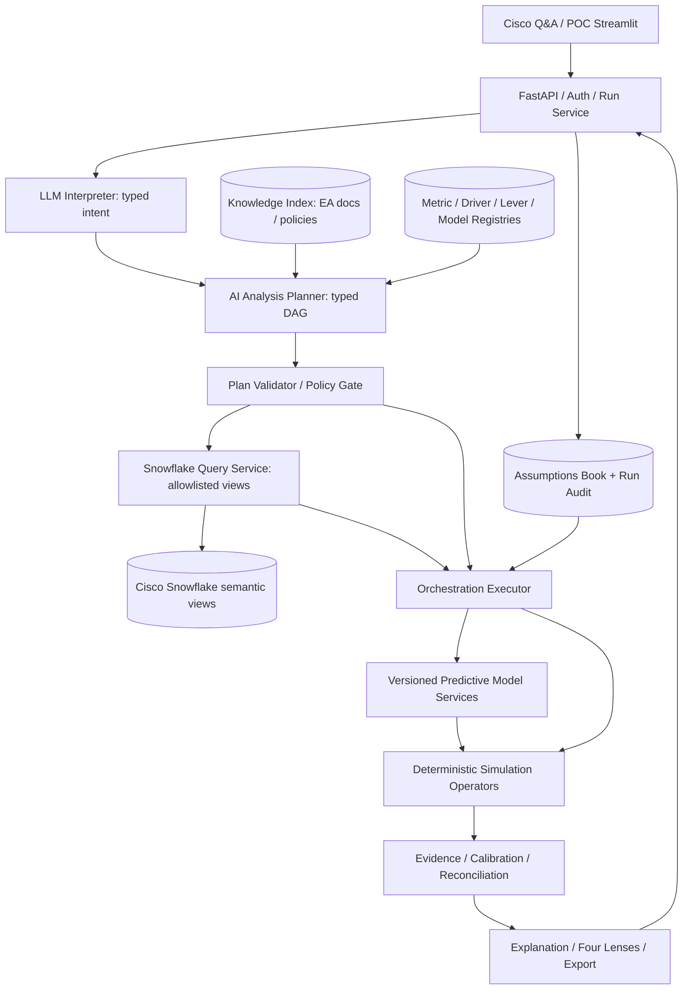
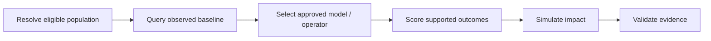

# Cisco EA What-If Intelligence Engine — Logical Components Explained

**Version:** 0.2  
**Updated:** 20 November 2026  
**Status:** Proposed design / developer walkthrough  
**Companion document:** `02_TECHNICAL_DESIGN.md`, Section 2, *Logical component diagram*

> **Scope and caveat:** This document explains the proposed logical architecture. Technology choices, semantic view names, model availability and Cisco production permissions are recommendations or illustrative examples, **not confirmed Cisco implementations**. The component names and connections below follow the diagram in the technical design.

## Updated logical component architecture (20 November 2026)

The original diagram is retained below as a record of the earlier proposal. The **controlling logical target** is now the 19-Nov deck's **one planner, four lens specialists, four-lens output**. Agent count is a logical separation of prompts/domain views, **not a mandatory requirement to deploy four independent LLM services**. Margin is out of scope.

```mermaid
flowchart TD
 U[Streamlit / Cisco Q&A] --> L[LLM typed interpreter]
 L --> P[Planner + 4 logical lens specialists]
 K[(RAG: EA policies + definitions)] --> P
 R[(Filters / Levers / Models / Formulas / KPI Registries)] --> P
 P --> G[Schema + policy + capability validation]
 G --> B[Baseline Engine: actual or no-change forecast]
 B --> D[(Read-only Snowflake views)]
 G --> E[Simulation Engine: levers + approved operators]
 B --> E
 E <--> M[Target-specific CatBoost + causal response models]
 E --> C[KPI Engine: metric definitions + deltas]
 B --> C
 C --> O[Growth | Discounting | Customer Value | Ops Cost & Simplicity]
 O --> X[Evidence-qualified explanation + export]
 X --> U
 A[(Audit, assumptions, approvals)] <--> E
```

### Refined component responsibilities

| Component | Owns | Does not do |
|---|---|---|
| LLM interpreter / planner | Parse question, identify relevant filters/levers, produce a typed DAG from approved metadata, choose explanation context | Invent signed financial formulas, valid values or confident causal results |
| Four lens specialists | Select/display relevant KPIs and business explanations per lens; may be configuration modules initially | Recompute financial rules independently or invent missing data |
| Registries | Filter/lever allowed/observed/model-supported ranges, formula IDs, KPI definitions, model versions, lever-to-KPI graph | Automatically approve all values found in PDFs |
| Baseline Engine | Historical observed actuals or projected no-change forecast with fixed cohort/horizon | Treat past bookings as future counterfactual without forecast qualification |
| Model Services | Renewal propensity, bookings/expansion, causal elasticity (when identifiable), cross-sell as later target | Implicitly prove causation from correlational prediction or SHAP |
| Simulation Engine | Interventions, model calls, event/cash-flow operators, calibrated Monte Carlo | Define independent ad-hoc KPI math outside approved formula book |
| KPI Engine | Canonical metrics, aggregation, baseline/scenario differences and four-lens data contract | Independently invent drivers or assumptions |
| RAG / Guidance | Business policy retrieval, provenance, reviewed rule-extraction candidates | Directly execute raw document prose as finance logic |
| Snowflake runtime | SQL/Snowpark, ML Jobs/Model Registry, optional Container Services and Cortex/Streamlit | Guarantee unsupported packages or access without Cisco approval |

**Planning and coverage:** a 23-Nov ready start leads to a *conditional* 11-Dec federal term demo; first phase takes ~4–6 weeks under data-ready, ~2-resource parallel assumptions. Provisional 14-/37-scenario scope estimates (~10–14/~16–24 weeks) refer to additional capabilities/tests, not separate trained models per scenario.

## 1. Complete logical architecture



**How to read this diagram:** The UI receives the question; the LLM converts it to structured intent; the planner assembles a typed, permitted workflow; data and models supply evidence; deterministic operators calculate outcomes; evidence checks qualify the result; and the UI displays the explanation. The audit/assumptions store supports execution and reproducibility. The arrows describe logical dependencies rather than every physical network call.

## 2. Component-by-component explanation

### 2.1 Cisco Q&A / POC Streamlit — user interface

**Purpose:** Let a Cisco analyst ask a natural-language what-if question and review the result. For the POC, Streamlit is an efficient front end; the production UI may be different.

**Inputs:** Question, population filters, selected comparison horizon, lever values, assumption overrides. **Outputs:** Request to API and rendered baseline/scenario comparison.

**Responsibilities:** Collect questions; request clarifications; display status, four decision lenses, uncertainty and citations; support changing assumptions and rerunning. **Not responsible for:** model training, direct unrestricted Snowflake SQL, or implementing scenario-specific financial formulas.

**Example:** An analyst asks, “What if federal EA terms move from three years to one year?” The UI sends the question and current filters to the API.

### 2.2 FastAPI / Auth / Run Service — secure backend entry point

**Purpose:** Authenticate and authorize the request, validate its shape, create an execution ID and coordinate the request lifecycle.

**Inputs:** Structured HTTP request from the UI. **Outputs:** Analysis plan, clarification request, run status or completed result.

**Responsibilities:** Identity/role checks; request schemas; run IDs; execution status; error handling; audit linkage; response delivery. **Suggested technology:** FastAPI and Pydantic with Cisco-approved SSO. The design proposes `POST /v1/whatif/plan` and `POST /v1/whatif/runs`.

**Boundary:** The API must not trust user-supplied role strings as proof of authorization; identity and permissions must come from an authenticated security context.

### 2.3 LLM Interpreter: typed intent — understand the question

**Purpose:** Convert a natural-language question into a machine-readable intent, not into a financial answer.

**Illustrative output:**

```json
{
  "intent": "what_if",
  "entity": "EA",
  "population": {"segment": "Federal"},
  "interventions": [
    {"driver": "contract_term_years", "from": 3, "to": 1}
  ],
  "horizon_years": null
}
```

**Responsibilities:** Identify affected population, intervention, baseline, requested metrics and missing information. **Suggested technology:** Cisco-approved LLM with structured outputs validated by Pydantic. **Key guardrail:** If the question does not specify a comparison horizon, leave it unresolved rather than silently inventing one.

### 2.4 AI Analysis Planner: typed DAG — choose the analytical workflow

**Purpose:** Turn interpreted intent into an ordered graph of required analytical operations. A **DAG** (directed acyclic graph) expresses task dependencies without loops.



**Responsibilities:** Discover metrics, drivers, data sources, predictive models and simulation operators from registries; decide task dependencies; identify gaps and clarification requirements. **Key guardrail:** Produce a typed plan using registered capabilities; do **not** generate unrestricted Python, arbitrary SQL or novel unapproved financial logic.

**Difference from interpreter:** Interpreter answers *“What did the user ask?”* Planner answers *“Which approved steps could answer it?”*

### 2.5 Knowledge Index: EA docs / policies — RAG context

**Purpose:** Retrieve relevant business documentation such as EA policies, renewal rules, discount constraints and metric definitions.

**Inputs:** Search intent and context. **Outputs:** Relevant passages with document IDs, versions and citations.

**Responsibilities:** Document ingestion, chunking/indexing, retrieval and provenance. **Suggested technology:** Snowflake Cortex Search or Cisco-approved retrieval service. **Limitation:** Retrieval can tell the planner what a term or policy means; it cannot predict bookings or establish a causal response to a new incentive.

### 2.6 Metric / Driver / Lever / Model Registries — discoverable capabilities

**Purpose:** Provide a governed catalog of what the system can measure, change, predict and calculate.

| Registry | Stores | Example |
|---|---|---|
| Metric | Definition, grain, aggregation, unit, lineage | Annualized bookings USD |
| Driver | Business variables and dependencies | Contract term, discount, adoption |
| Lever | Allowed intervention, units, bounds, eligibility | Term changes: 1/3/5 years |
| Model | Model version, target, features, validity, approval | `term_bookings_v1` |

**Illustrative model metadata:**

```yaml
id: term_bookings_v1
kind: catboost_regressor
target: annualized_bookings_usd
features: [suite, segment, historical_bookings, term_years]
valid_term_years: [1, 3, 5]
approval_status: experimental
```

**Responsibilities:** Make capabilities reusable across scenarios, enforce stable definitions, track ownership and versions. **Important:** A registered model predicting bookings does not automatically prove the *causal* effect of changing term length. That claim requires separate validation or approved assumptions.

### 2.7 Plan Validator / Policy Gate — reject unsafe or unsupported plans

**Purpose:** Check the proposed analysis before any data access or execution.

**Checks:** User permission; allowlisted data objects; registered metrics and operators; required inputs; allowed driver ranges; model applicability; query limits; cost/time budgets; data availability; policy compliance.

**Outputs:** Approved plan, clarification request or rejection with reasons.

**Example:** If a planner requests a churn model that is not registered or approved, the gate blocks the operation rather than allowing the LLM to invent churn numbers.

### 2.8 Snowflake Query Service: allowlisted views — governed structured data access

**Purpose:** Fetch observed Cisco facts and baselines from approved Snowflake views, using validated filters and approved query templates.

**Responsibilities:** Read-only access, predicate validation, aggregation pushdown, parameterized queries, result metadata, query ID and lineage capture, timeout/resource controls. **Suggested technology:** Snowflake Connector/Snowpark.

**Example:** Retrieve observed bookings for the eligible federal EA population over the agreed historical window. The service should not expose unrestricted production table access to the LLM.

#### Cisco Snowflake semantic views — source-facing business layer

These views give stable definitions for customer, contract, bookings, renewal and other domains. Suggested logical objects in the technical design include `EA_SEMANTIC.BOOKINGS`, `EA_SEMANTIC.CUSTOMER`, `EA_SEMANTIC.RENEWAL_EVENTS`, `EA_SEMANTIC.CONSUMPTION` and `EA_SEMANTIC.OPERATIONS`. **These are illustrative names, not verified existing Cisco views.**

### 2.9 Orchestration Executor — run the approved DAG

**Purpose:** Execute the validated plan in dependency order.

**Responsibilities:** Run Snowflake queries, prepare features, call approved inference services, execute simulations, manage retries/timeouts, track intermediate artifacts and handle partial failures. **Suggested technology:** Python workflow runner; LangGraph may be considered if stateful agent execution is needed.

**Difference from planner:** Planner *specifies* the tasks; executor *performs* them.

### 2.10 Versioned Predictive Model Services — CatBoost inference

**Purpose:** Serve previously trained models to estimate supported outcomes.

**Example inference input:**

```json
{
  "suite": "Illustrative Suite",
  "segment": "Federal",
  "historical_bookings": 1000000,
  "term_years": 1
}
```

**Output:** Prediction plus model ID/version, feature schema, validity flags and relevant uncertainty/error metadata.

**Where training happens:** Separately, offline or on an approved schedule. Historical labeled Snowflake data is cleaned, joined, transformed into point-in-time features, split chronologically, trained and evaluated. Approved artifacts are registered and deployed for inference. **The model is not retrained every time a user asks a question.**

**Modeling caveat:** Different outcomes require different targets and labels: bookings, renewal, churn and workload cannot reliably be learned from one universal CatBoost target. Unseen policy interventions may require causal analysis or assumptions rather than simple supervised scoring.

### 2.11 Deterministic Simulation Operators — calculate scenario consequences

**Purpose:** Apply tested, versioned business math to observed baselines and model predictions.

**Examples:** Common-horizon comparisons, annualized metrics, discounted cash flows/NPV, renewal workload, baseline-to-scenario deltas, sensitivity, breakeven and Monte Carlo uncertainty when valid distributions are supplied.

```text
incremental_bookings = scenario_bookings - baseline_bookings
```

**Responsibilities:** Approved formulas, unit consistency, versioning, reproducibility, parameter bounds and test coverage. **Difference from predictive ML:** A model estimates an outcome from historical patterns; a simulation operator combines facts, predictions and approved assumptions into a business calculation.

### 2.12 Evidence / Calibration / Reconciliation — qualify numerical results

**Purpose:** Establish whether the answer is supported, consistent and adequately calibrated.

**Checks:** Baseline totals reconcile with Snowflake; data freshness and coverage; missingness; model input distribution and applicability; model performance; assumption provenance; consistency of financial units and comparison horizon; uncertainty and unsupported extrapolation.

**Outputs:** Evidence bundle, warnings, confidence/coverage notes and explicit abstention where evidence is insufficient. **Example:** A result based on an unseen contract type must be marked as assumption-driven or unsupported rather than labeled a validated forecast.

### 2.13 Explanation / Four Lenses / Export — communicate business decisions

**Purpose:** Present validated analysis in the four proposed decision lenses from the 19-Nov deck.

| Lens | Question | Potential measures (only where supported) |
|---|---|---|
| Growth | Does the intervention improve commercial outcomes? | Bookings, expansion, renewal |
| Discounting | How do pricing and concessions change? | Programmatic/non-standard discounts, credits, price protection |
| Customer Value | How does it affect customers? | Retention, flexibility, price impact |
| Ops Cost & Simplicity | What operating burden does it introduce? | Invoice count, approvals, processing effort |

**Responsibilities:** Show observed baseline, proposed intervention, modeled scenario, deltas, assumptions, uncertainty, source references and limitations; provide export/reporting. **Guardrail:** The LLM may explain computed results but must not fabricate missing numerical metrics or turn proxies into observed outcomes.

### 2.14 Assumptions Book + Run Audit — reproducibility and governance

This is the supporting store shown at the bottom of the logical diagram, not an additional predictive engine.

**Assumptions Book:** Approved values, sources, owners, versions, ranges and overrides. **Run Audit:** Run ID, user/role, intent and plan versions, source view/query IDs or hashes, model versions, operator versions, input timestamps, assumptions, warnings and outputs.

**Example audit fragment:**

```json
{
  "run_id": "EA_RUN_001",
  "model_id": "term_bookings_v1",
  "baseline_source": "EA_SEMANTIC.BOOKINGS",
  "assumptions_version": "v1",
  "status": "completed"
}
```

This fragment is illustrative; a production record needs richer provenance and access controls.

## 3. End-to-end walkthrough: one-year terms for federal customers

**User question:** “What if Cisco offers one-year EA contracts instead of three-year contracts to federal customers?”

| Step | Component | Action |
|---|---|---|
| 1 | Streamlit | Capture question and filters |
| 2 | API / Auth | Authenticate, authorize and create run |
| 3 | Interpreter | Extract federal population and 3-to-1-year intervention |
| 4 | Knowledge Index | Retrieve relevant term/renewal rules |
| 5 | Registries | Discover metrics, drivers, model/operator availability |
| 6 | Planner | Build typed DAG and identify missing horizon |
| 7 | Validator | Request clarification or approve bounded plan |
| 8 | Query Service | Fetch observed baseline from approved Snowflake views |
| 9 | Executor | Prepare features and run approved operations |
| 10 | Predictive Services | Score applicable outcomes using registered model versions |
| 11 | Simulation | Compute comparable-horizon financial effects |
| 12 | Evidence | Reconcile and flag uncertainty or unsupported claims |
| 13 | Explanation | Present four lenses and supporting evidence |
| 14 | Assumptions / Audit | Persist assumptions, lineage and run metadata |

**Critical distinction:** A model's correlation between term length and bookings does not by itself demonstrate what would happen *because* Cisco changes term policy. A causal estimate, historical intervention evidence or an explicit assumption-based scenario is needed for that interpretation.

## 4. Training versus inference versus retrieval

| Component | Requires supervised ML training? | Activity |
|---|---|---|
| LLM Interpreter | No initial fine-tuning required | Prompting / structured extraction |
| AI Planner | No initial fine-tuning required | Structured planning / tool selection |
| Knowledge Index | No CatBoost training | Indexing and embedding approved documents |
| Registries | No | Configuration and governance |
| Query Service | No | Query observed Snowflake data |
| Predictive Model Services | **Yes, per supported target** | Offline training; online/batch inference |
| Simulation Operators | No | Approved deterministic math |
| Evidence Layer | Not inherently | Validation and statistical calibration |
| Explanation Layer | No initial fine-tuning required | Explain grounded outputs |

**Recommended lifecycle:** (1) Build certified historical training datasets; (2) train and validate outcome-specific models; (3) register approved versions; (4) deploy inference endpoints; (5) serve questions using existing versions; (6) monitor and retrain based on drift or an approved cadence. Quarterly recalibration is a planning option, not a guarantee that every model should be retrained quarterly.

## 5. Suggested POC module boundaries

The logical architecture **does not** require 14 microservices. For a POC, group it into five deployable/code modules:

1. **UI/API:** Streamlit and FastAPI, authentication stub for synthetic local demo.
2. **AI intelligence:** Intent interpreter, planner, RAG adapter and registries.
3. **Data access:** Synthetic CSV adapter first; governed Snowflake adapter after approval.
4. **Analytical engine:** Executor, CatBoost inference adapter and simulation operators.
5. **Governance/results:** Validation, evidence, assumptions, audit and explanation.

### Proposed POC demonstration sequence

- **Question A:** One-year versus three-year terms for an eligible population; show baseline, selected model, scenario and limitations.
- **Question B:** True Forward cap adjustment; demonstrate a different operator/capability without adding a scenario-ID-specific workflow.
- **Question C:** Novel loyalty incentive without sufficient historical labels; demonstrate correct unsupported-evidence behavior rather than invented uplift.

The first local demonstration can use synthetic data and deterministic adapters. **Do not claim live Cisco Snowflake access, RAG retrieval or production-trained CatBoost until those integrations are actually implemented and tested.**

## 6. Key design decisions to confirm with Cisco

1. Which semantic views and source domains are approved, and what are their authoritative metric definitions?
2. Which predictive targets have reliable historical labels and valid intervention support?
3. Who owns and approves financial formulas, policy assumptions and model deployments?
4. What does “no hardcoding” mean operationally: no scenario routing, configurable drivers, or unrestricted novel economic mechanisms?
5. What is the first bounded client acceptance scenario, and what accuracy, latency and audit criteria apply?

## 7. Implementation principle

**The AI planner decides which registered capabilities to invoke. The analytical engine performs approved data retrieval, inference and calculations. The evidence layer decides what can responsibly be claimed.** This separation supports new questions while protecting financial credibility and auditability.

## Document alignment and decision status (20 November 2026)

**Latest deck baseline:** `Cisco_EA_WhatIf_Approach (1).pptx`, dated 19 November 2026, is the controlling **proposed client discussion narrative** for this revision. It specifies **four lenses**: **Growth, Discounting, Customer Value, and Ops Cost & Simplicity**. Earlier scope and architecture decks described **three lenses**; this is a revision that requires Cisco confirmation and consistent metric ownership.

**Evidence vs proposal:** The deck states the desired workflow and a draft calendar; it is not proof that all four lenses have usable data, causal lever-effect estimates, approved formulas, trained models, or production access. Items marked **Proposed** below are implementation recommendations. Items marked **Pending Cisco sign-off** are not established requirements. Its federal term-flexibility walkthrough contains illustrative directional impacts, not validated quantitative predictions.

**Other inputs:** `Cisco_EA_Architecture_Combined(2).pptx`; `Cisco_EA_Lever_Modelling_Scope_v4(2).pptx`; `EA Modeling Scenarios and Data Readiness(1).xlsx`; the 16-Nov term flexibility POC deck; manager's four-model + Monte Carlo suggestion; and the follow-up 14-/37-scenario planning discussion. The 14 and 37 counts are planning comparisons, not model counts or a promise of coverage. The 11-Dec-2026 federal demo is a *conditional proposed milestone*, not a promise of four fully measured lenses.
