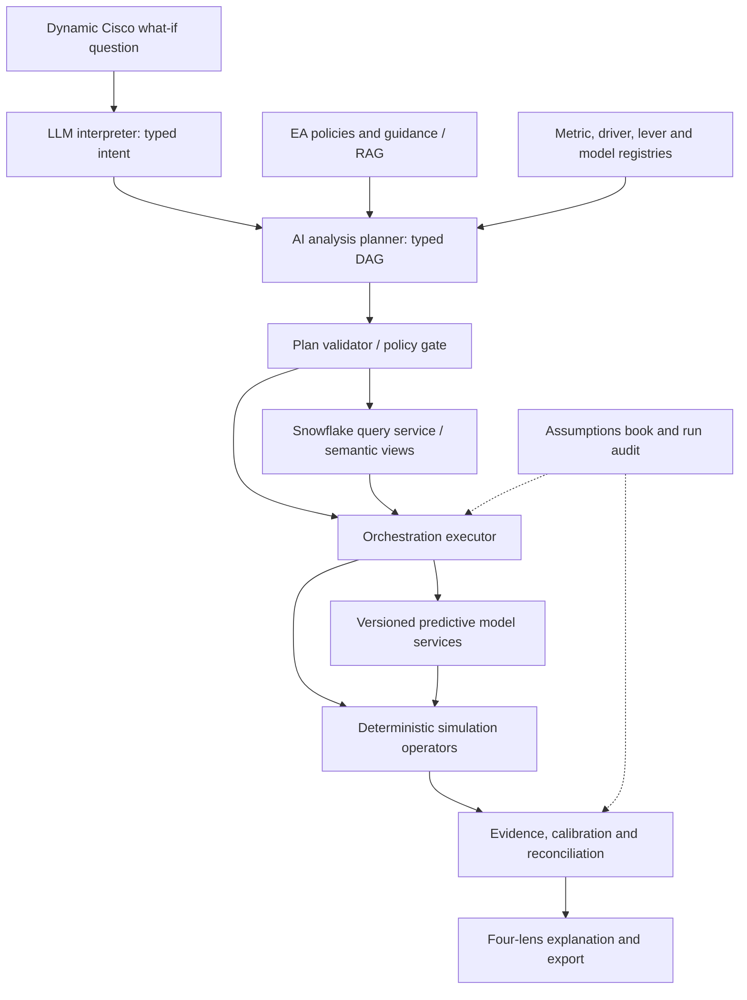
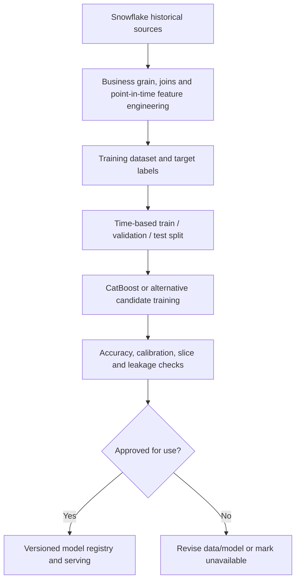
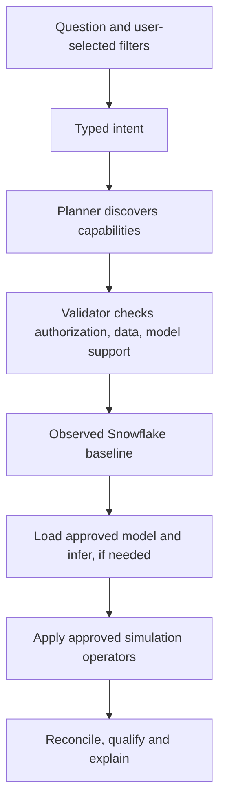

# Cisco EA What-If Modeling — Dynamic Scenarios and Predictive Model Training Strategy

**Document type:** Architecture decision and implementation guidance  
**Companion documents:** `01_FUNCTIONAL_REQUIREMENTS.md`, `02_TECHNICAL_DESIGN.md`, `03_POC_IMPLEMENTATION.md`, `04_LOGICAL_COMPONENTS_EXPLAINED.md`  
**Status:** Proposed design for Cisco stakeholder validation  
**Updated:** 20 November 2026

## Revised model portfolio and scope gate (20 November 2026)

The 19-Nov deck identifies **renewal propensity, expansion/bookings, and lever elasticity** in its proposed build; the manager additionally recommended cross-sell and Monte Carlo. These are complementary to the target-specific, reusable-model approach, but **do not imply one model per scenario**.

| Capability | Outcome/estimator | Data and modeling caution | Sequencing |
|---|---|---|---|
| Renewal propensity | Renewed vs not within Cisco-approved, matured renewal window; CatBoost classifier | Amendments, partial renewals, censoring and calibrated probabilities | First if labels complete |
| Expansion/bookings | Next-term bookings/expansion dollars; CatBoost regression, test Tweedie vs alternatives | Avoid mixing booking/expansion targets, discount double-count and target leakage | First if label complete |
| Lever elasticity | Log-linear historical relationship; Double ML or other causal method where identifiable | Discount/free quantity assigned to at-risk deals; must check confounding, positivity, temporal ordering | Investigation/validation; do not promise causal result by 11-Dec |
| Cross-sell | Acquisition of a new suite in fixed horizon; CatBoost classifier | Need suite-level histories and correct negative examples | Later unless data is ready |
| Monte Carlo | P10/P50/P90 portfolio result distributions | **A simulation technique, not a fifth trained predictor**; calibrated dependency structure needed | After model uncertainty support |

**Model–KPI composition:** standard regression coefficients (even on a log scale) and SHAP are not causal impact estimates. Do not apply discount/term response twice if the prediction model already reflects the changed intervention. Apply monotone constraints only for documented causal/contractual reasons and holdout-confirmed segment behavior; the green/red hypothesis sheet is not a universal constraint set.

**Four-lens linkage:** Growth (bookings, land/expand/renew); Discounting (standard/nonstandard discounts and protection); Customer Value (adoption, consumption, product breadth/renewal health); Ops Cost & Simplicity (approvals, amendments, renewal events, billing cycles). Some lens KPIs are rule-based and **do not require dedicated training targets**; data sources for two lenses remain unconfirmed. Margin excluded.

**Model acceptance:** customer-disjoint time-based holdouts, PR-AUC+calibration for classifier, MAE/WAPE for financial regressors; support overlap, confounding diagnostics and sensitivity for causal lever effects; model cards with prediction horizon, valid intervention region, feature availability time and approval owner. A stored model may serve multiple differently phrased supported questions without retraining.

**Phasing:** 11-Dec conditional single-scenario demo, 2–3 models in an integrated POC after ~4–6 weeks only if labels and compute ready, broader 14/37 scenario coverage driven by distinct targets, new data, operators and validation—not scenario count alone.

## 1. Executive summary

**We should train multiple reusable predictive models where the historical data supports them, but not one model per scenario.** Cisco's questions, filters, levers and combinations can be dynamic; supervised ML models still require defined prediction targets, historical labels, valid input features and explicit applicability boundaries.

The architecture separates:

1. **Question interpretation and planning:** an LLM identifies intent, population, interventions, metrics, constraints and required capabilities.
2. **Governed data and business knowledge:** Snowflake semantic views provide observed data; RAG provides policy and business context.
3. **Reusable outcome models:** validated models estimate specific outcomes such as bookings, renewal, expansion or churn when data permits.
4. **Deterministic simulation:** approved operators combine model outputs with contract mechanics, assumptions, cash-flow formulas and sensitivity calculations.
5. **Evidence and explanation:** reconcile baselines, quantify uncertainty, report assumptions and abstain where evidence is insufficient.

The key architectural principle is **dynamic composition of approved capabilities, not arbitrary generation of new prediction logic at question time**.

## 2. Logical modeling architecture



The predictive services can include multiple CatBoost models, other model families or no ML at all for an entirely rule-based scenario. **The diagram is a proposed logical architecture; each box need not be a separate deployed microservice in the POC.**

## 3. What is trained — and what is not?

| Component | Training needed? | Responsibility |
|---|---|---|
| LLM interpreter | No initial fine-tuning required | Parse business question into structured intent |
| AI planner | No initial fine-tuning required | Select registered queries, models and operators |
| RAG knowledge index | Indexing/embeddings, not CatBoost training | Retrieve EA policies and definitions |
| Semantic and capability registries | No | Define metrics, drivers, constraints, models and operators |
| Snowflake query service | No | Retrieve approved historical and current data |
| Predictive models | **Yes, where historical labels exist** | Predict defined outcomes |
| Simulation operators | No | Calculate approved financial/operational effects |
| Evidence/reconciliation | No conventional predictive training required | Validate inputs, outputs, applicability and uncertainty |
| Explanation layer | No initial fine-tuning required | Present grounded results and limitations |

**Training** happens offline or on a governed schedule. **Inference** happens when a user submits a supported question. Asking a new question does not automatically retrain a model.

## 4. Candidate predictive capabilities

These are *candidate* models, not a committed count or an assertion that Cisco has all necessary labels.

| Outcome capability | Candidate target | Example features | Data prerequisite |
|---|---|---|---|
| Bookings | Future annualized bookings, or bookings over a specified horizon | Segment, suite, contract term, historical bookings, region, discount | Time-stamped booking history and reliable future outcome |
| Renewal | Probability of renewal within a defined window | Contract age, term, usage, price, customer history | Historical renewals and non-renewals, observation windows |
| Expansion | Expansion amount or expansion event | Adoption, installed base, growth, prior spend | Identifiable expansion events and timestamps |
| Churn | Churn/non-renewal probability | Usage, term, price, renewal history | Consistent churn definition and outcome labels |
| Adoption | Future adoption/consumption | Product, installed base, customer characteristics, historical usage | Longitudinal consumption/adoption data |
| Operational effort | Processing time, transaction count or operating cost | Contract complexity, frequency, amendment volume | Measured operational outcomes or approved cost rules |

Some outcomes overlap: for example, renewal and churn may be two views of the same event depending on the business definition. **Do not train redundant models without a distinct decision need.**

### 4.1 Define the prediction contract before training

Every model must document:

- **Prediction target:** exact meaning, units and time horizon (for example, renewal in the next 90 days).
- **Grain:** one training row per customer-contract-suite-snapshot, or another approved business unit.
- **Observation date:** the point at which features would have been known.
- **Features:** permitted inputs and their as-of timestamps; no future leakage.
- **Output:** prediction, uncertainty or reliability diagnostics, and model version.
- **Applicability:** supported segments, terms, regions, discount ranges and data freshness.
- **Validation:** time-based holdout, slice performance, calibration where relevant, business reconciliation and approval status.
- **Causal status:** predictive association, validated intervention response, or assumption-based sensitivity; do not conflate these.

### 4.2 Example reusable bookings model

```python
features = [
    "customer_segment",
    "region",
    "suite_name",
    "contract_term_years",
    "discount_percentage",
    "historical_bookings_usd",
    "customer_tenure_months",
]
target = "future_annualized_bookings_usd"
```

A single trained model **may** be applicable to several user questions, including one-year versus three-year terms, discount changes, five-year contracts, or combinations of both, **only when the requested input combinations and interpretation of the intervention have been validated**. A model that predicts bookings from observed term and discount is not automatically a causal pricing-response model.

## 5. Why not one model per Cisco scenario or cluster?

The scenarios workbook is best treated as **coverage and acceptance-test material**, not a list of independent models to train. The six business clusters organize use cases and ownership; they do not necessarily define six ML targets.

| Business question or mechanic | Likely analytical capabilities |
|---|---|
| Flexible 1-, 3- or 5-year terms | Bookings predictor, renewal predictor if available, common-horizon financial simulation |
| True Forward cap | Contract-rule calculation; growth/consumption forecast only if needed |
| Early renewal incentive | Renewal response model if historically supported; otherwise assumption sensitivity |
| Discount adjustment | Price/booking response evidence and approved financial formulas |
| Growth allowance | Consumption/expansion forecast plus allowance rules |

One scenario may call multiple models; several scenarios may share one model; some require **no** predictive model.

## 6. Two distinct operating pipelines

### 6.1 Offline training and model governance



Recommended sequence:

1. Inventory source tables, keys, available dates, historical depth, definitions and permissions.
2. Define outcome targets and prediction horizons with Cisco business owners.
3. Create stable semantic views and time-correct feature tables.
4. Train baselines first, then CatBoost or alternative candidates.
5. Evaluate with temporal holdouts and important business segments.
6. Test counterfactual applicability; distinguish prediction from causal impact.
7. Approve and register models with version, owner, features and supported ranges.
8. Monitor drift, data changes and performance; retrain only when justified.

A quarterly retraining review may be a starting point, but cadence should be determined by outcome drift and Cisco's operational requirements.

### 6.2 Online question execution



The online pipeline invokes **previously trained** models. It must not silently train a new model from live user questions or execute unapproved financial formulas generated by an LLM.

## 7. What does “train on all Cisco data” mean?

It does **not** mean concatenating every Snowflake table into one giant CatBoost dataset. The source estate may contain bookings, subscriptions, customer hierarchies, consumption, contract events and financial transactions with different grains and timestamps.

Instead:

1. Identify the business outcome and the point-in-time entity to predict.
2. Map relevant source systems and join keys.
3. Build certified features from the relevant subset of historical records.
4. Avoid duplication from many-to-many joins and repeated subscription records.
5. Ensure training examples use only data known at the observation time.
6. Create a separate supervised target for each distinct outcome.
7. Use Snowflake to filter, aggregate and materialize features efficiently rather than exporting the full raw estate unnecessarily.

**Large row counts do not compensate for missing labels, weak history, biased treatment assignment or unreliable definitions.** The reported 280-million-row scale is a planning context, not a validated training-set size or a requirement to use every record.

## 8. How a novel question is handled

**Question:** “What if Cisco offers a 7% discount to customers who renew six months early?”

1. **Interpret:** Identify the early-renewal eligibility rule, 7% discount lever, affected customer population and desired outcomes.
2. **Discover:** Retrieve relevant EA policies, metrics, approved Snowflake views and model capabilities.
3. **Validate:** Determine whether any model is valid for early-renewal incentives and the specified discount range.
4. **Baseline:** Compute the observed current-state portfolio and cash-flow basis.
5. **Simulate:** Invoke supported models and approved financial operators; use a common comparison horizon.
6. **Check:** Reconcile calculations, disclose assumptions and quantify uncertainty.
7. **Explain:** Present Growth, Customer Value and Simplicity with Scale, with audit references.

If no historical evidence supports the incentive's behavioral effect, the engine should **not** invent an uplift. It may provide a labeled assumption-driven sensitivity analysis (for example, different assumed renewal-rate changes) or request additional data and business approval.

## 9. Prediction is not the same as causal what-if estimation

This distinction is a major delivery risk. A supervised CatBoost model may learn that five-year contracts correlate with higher bookings, but those customers may already be larger or more committed. Changing a three-year customer's contract to five years does not necessarily cause the same difference.

To make intervention claims, evaluate the evidence available:

- Randomized or quasi-experimental policy variation, where available.
- Historical treatment variation with credible adjustment for confounders.
- Causal inference / uplift approaches when identification assumptions are defensible.
- Approved structural business rules for mechanically determined outcomes.
- Explicit assumption-driven sensitivity ranges when causal evidence is absent.

Tag every numerical result as **observed**, **predictive**, **causally estimated**, **rule-calculated**, or **assumption-based**. The explanation layer should preserve those labels.

## 10. Dynamic capability discovery and model registry

The planner should discover capabilities from governed metadata rather than hardcoded scenario IDs. Example *illustrative* registry entry:

```yaml
id: term_bookings_v1
kind: catboost_regressor
predicts: future_annualized_bookings_usd
required_features:
  - customer_segment
  - region
  - suite_name
  - contract_term_years
  - historical_bookings_usd
supported_term_years: [1, 3, 5]
status: experimental
causal_claim_supported: false
owner: pending_cisco_confirmation
validation_report: pending
```

A plan validator must reject unsupported targets, missing features, out-of-range interventions, unapproved models, unauthorized Snowflake access and undefined metrics. The model registry should expose versioned interfaces, not only filenames.

## 11. Recommended phased POC

### Stage 1 — Reuse the existing term-flexibility models

- Register the current CatBoost artifacts with explicit features, targets, validation status and limitations.
- Wrap inference behind a stable service interface.
- Build a typed LLM question interpreter and governed planner.
- Support several term-related phrasings and filters without separate scenario IDs.
- Compare one-, three- and five-year terms using consistent horizon and metric definitions.

**Proof point:** A question can dynamically select and execute an existing model. This does not prove arbitrary new interventions are supported.

### Stage 2 — Add a different analytical capability

- Implement a True Forward cap operator with approved business rules and test data.
- Add it to the same registry and planner.
- Demonstrate that the engine routes term-flexibility and True Forward questions differently without separate UI workflows.

**Proof point:** The planner composes different analytical capabilities, including a scenario that may not require ML.

### Stage 3 — Add a second trained outcome model if labels permit

- Validate the availability of historical renewal outcomes.
- Train and evaluate a renewal model using time-correct features.
- Demonstrate a multi-model scenario that combines bookings and renewal predictions, with explicit assumptions about any dependency between them.

**Proof point:** Multiple outcome models can contribute to one business simulation. If labels are unavailable, demonstrate a rule-only or assumption-based capability and document the gap.

### Suggested client demonstration questions

1. “What happens if federal EA customers move from three-year to one-year contracts?”
2. “What if we cap True Forward adjustments for a selected customer group?”
3. “What happens if we introduce an early-renewal reward that has no historical precedent?”

For the third question, a **correct refusal to fabricate a prediction**, paired with a transparent sensitivity option, is a successful governance demonstration.

## 12. Acceptance criteria for the modeling architecture

- [ ] Questions are interpreted into validated, typed intents rather than scenario identifiers.
- [ ] The planner selects registered capabilities based on target, features and intervention support.
- [ ] Two materially different question types run through the same orchestration framework.
- [ ] Model training and online inference are separated.
- [ ] All model artifacts have versions, owners, evaluation records and applicability constraints.
- [ ] Observed baselines reconcile to approved Snowflake data within agreed tolerances.
- [ ] Simulation outputs include horizon, units, assumptions and uncertainty or a clear limitation.
- [ ] Unsupported novel interventions are flagged instead of receiving fabricated predictions.
- [ ] Four-lens reporting does not present unmeasured proxies as observed outcomes.
- [ ] Each run has auditable query references, model/operator versions and assumption versions.

## 13. Three levels of dynamism — agree scope with Cisco

| Level | Capability | Recommended position |
|---|---|---|
| **1 — Dynamic composition** | New wording and combinations using existing approved models/operators | Immediate POC target |
| **2 — Metadata-extensible analysis** | Add drivers, metrics, views and capabilities through governed metadata and validation | Production design target |
| **3 — Unrestricted novel intervention learning** | Automatically infer reliable effects of never-seen business interventions | **Not guaranteed** by an LLM, RAG or CatBoost; requires evidence and validation |

The phrase “any question without hardcoding” should be translated into measurable expectations. Level 1 is a realistic first proof point; Level 2 is the extensibility goal. Level 3 cannot be promised as a general property of the architecture.

## 14. Open decisions and dependencies

1. Which outcome targets (bookings, renewals, churn, expansion, consumption, operations) have usable labels and historical depth?
2. What is the agreed prediction grain, forecast horizon and business definition for each target?
3. What contract-term and discount variation exists, and is it suitable for causal estimation?
4. Which Snowflake semantic views and access controls can be approved early?
5. Which business owner approves financial operators and assumptions?
6. How should the system respond when a question is interpretable but no valid model or data exists?
7. What is the first client acceptance demonstration: dynamic term questions, cross-cluster routing, or multi-model inference?
8. How are the four lenses measured, especially customer value and operational simplicity, where direct observations may be missing?

## 15. Final recommendation

**Train a portfolio of reusable, outcome-oriented models only where the data supports them.** Keep the six clusters as business organization and coverage categories, not an automatic six-model requirement. Let the LLM interpret and plan, let governed data and registries constrain what is possible, and let approved models and simulation operators produce numbers.

For the next Cisco POC, **retain the existing CatBoost work**, register it as the first capability, add a second non-ML business operator, and prove that dynamic questions can select and compose those capabilities without scenario-specific code. Expand the predictive portfolio after validating Cisco's actual target labels, historical data and intervention evidence.

---

### Source alignment and scope notes

This strategy builds on the previously discussed Cisco EA architecture, Scope v4, scenario workbook, client meeting feedback and existing term-flexibility POC. The candidate model inventory, proposed training contracts, governance controls and staged implementation are **design recommendations**, not statements that Cisco has already approved those models or that all necessary data is available. Refer to the companion functional and technical documents for detailed architecture and requirements traceability.

## Document alignment and decision status (20 November 2026)

**Latest deck baseline:** `Cisco_EA_WhatIf_Approach (1).pptx`, dated 19 November 2026, is the controlling **proposed client discussion narrative** for this revision. It specifies **four lenses**: **Growth, Discounting, Customer Value, and Ops Cost & Simplicity**. Earlier scope and architecture decks described **three lenses**; this is a revision that requires Cisco confirmation and consistent metric ownership.

**Evidence vs proposal:** The deck states the desired workflow and a draft calendar; it is not proof that all four lenses have usable data, causal lever-effect estimates, approved formulas, trained models, or production access. Items marked **Proposed** below are implementation recommendations. Items marked **Pending Cisco sign-off** are not established requirements. Its federal term-flexibility walkthrough contains illustrative directional impacts, not validated quantitative predictions.

**Other inputs:** `Cisco_EA_Architecture_Combined(2).pptx`; `Cisco_EA_Lever_Modelling_Scope_v4(2).pptx`; `EA Modeling Scenarios and Data Readiness(1).xlsx`; the 16-Nov term flexibility POC deck; manager's four-model + Monte Carlo suggestion; and the follow-up 14-/37-scenario planning discussion. The 14 and 37 counts are planning comparisons, not model counts or a promise of coverage. The 11-Dec-2026 federal demo is a *conditional proposed milestone*, not a promise of four fully measured lenses.
