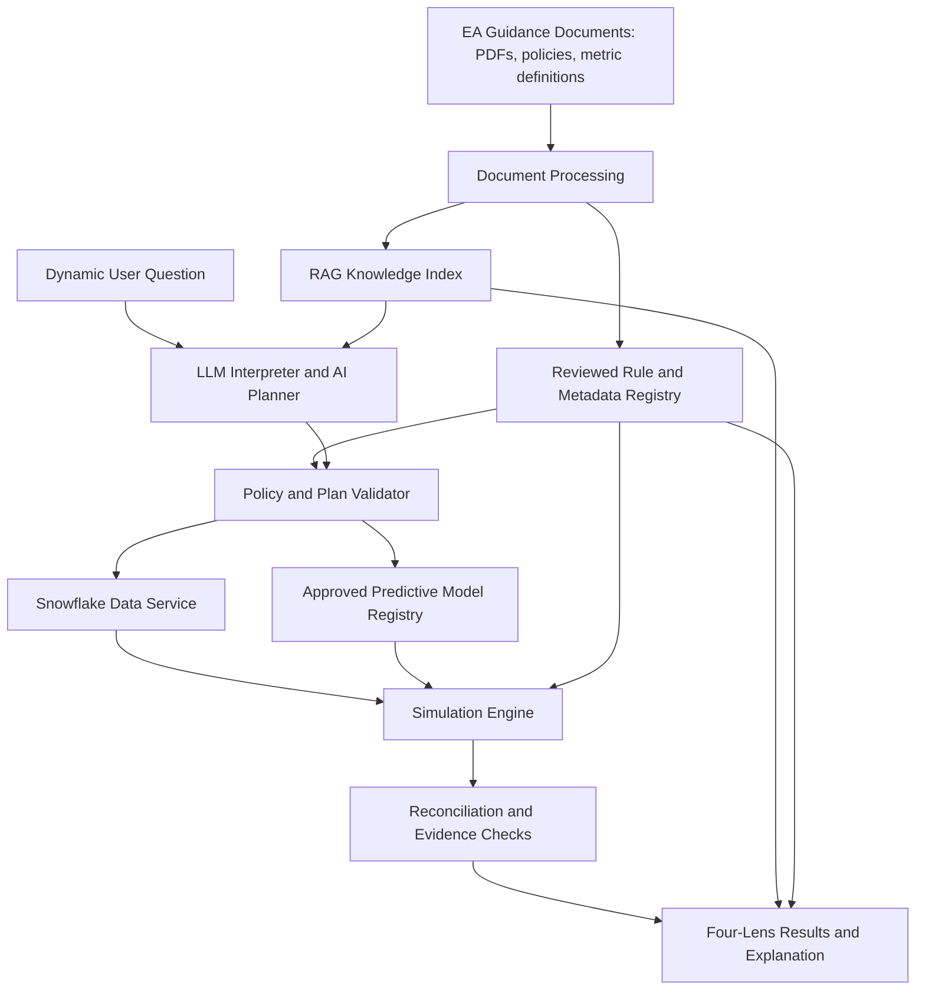

# Cisco EA Lever Modeling — Guidance Data Integration Strategy

## Revision: guidance, finance approvals and four lenses (20 November 2026)

The 19-Nov deck requires **Growth, Discounting, Customer Value, and Ops Cost & Simplicity** as four proposed output lenses, with margin explicitly excluded. Guidance is used **before** model training (label/metric meanings), **during** dynamic planning (lever applicability, allowed values, policy selection), and **after** modeling (explain tradeoffs and evidence), but must not directly produce numeric predictions.

**Policy-control design:** ingest approved EA PDFs with effective date, document version and owner; RAG retrieves candidate statements; subject-matter experts approve extracted eligibility, pricing and metric rules; only then publish typed entries to **Filter, Lever, Formula/Business Rule and KPI Registries**. The LLM selects allowed candidates and explains their sources—it does not generate authoritative percentages, formulas or runnable Python.

**Four lens evidence plan:** Growth may initially use certified bookings; Discounting needs vetted standard/nonstandard price definitions; Customer Value needs adoption/installed-base/consumption views; Ops Cost needs quoting/deal-desk/approval, billing and event-cost views. Until signed off, a lens must show `not_available`, an approved proxy, or explicitly hypothetical estimates, never an invented metric. Margin is excluded.

**Rule lifecycle:** source PDF → parsing/retrieval → proposed structured rule → SME review → approved version/effective date → executable registry entry → simulation/KPI test → audit. Conflicts/expired policy produce review blocks, not best-guess reconciliation.

**Milestone gate:** an 11-Dec federal term demo may use a measured subset of the four lenses plus transparent gap labels. Do not commit to all four being quantitatively populated before receiving the required sources.

## 1. Executive Summary

Guidance data should be used **before modeling, during dynamic scenario execution, and after modeling**. It serves a different purpose from structured Snowflake data:

- **Structured data** supplies historical evidence for model training, baseline calculations, and financial outcomes.
- **Guidance data** supplies business definitions, EA policies, calculation rules, eligibility conditions, approved assumptions, and interpretation guidelines.

**Recommendation:** Implement guidance as a governed business knowledge layer, not as raw PDF text fed directly into CatBoost. Retrieval-augmented generation (RAG) supports discovery and explanations; reviewed structured rules govern calculations and constraints.

## 2. Logical Architecture



## 3. Pre-Modeling: Define the Business Problem Correctly

Guidance documents help define the training problem and prevent technically sound models from predicting incorrectly defined business metrics.

For the term-flexibility POC, review guidance for:

- Eligible one-, three-, and five-year EA agreement terms.
- Definitions and formulas for bookings, annualized bookings, and related financial metrics.
- Monetization types and customer populations to include or exclude.
- Treatment of renewals, contract overlaps, and effective dates.
- Approved feature definitions, target definitions, and policy constraints.

### Implementation steps

1. Ingest and classify guidance documents with document version and effective date.
2. Extract candidate business definitions and rules, with source references.
3. Have business owners review and approve extracted definitions.
4. Store approved definitions in versioned metric, driver, lever, and rule registries.
5. Use those definitions to create point-in-time training datasets and validation checks.

**Guardrail:** Do not let an LLM independently redefine metrics or training targets on every run. Avoid using future information as historical model features.

## 4. During Modeling: Interpret and Govern Dynamic Scenarios

Example user question:

> What if we offer one-year EA contracts with a 10% discount to enterprise customers?

| Step | Component | How guidance contributes |
|---|---|---|
| 1 | LLM Interpreter | Resolves EA terminology and identifies term, discount, and segment concepts. |
| 2 | AI Planner | Discovers relevant metrics, drivers, levers, and approved methods. |
| 3 | Policy / Plan Validator | Checks eligibility, constraints, approval requirements, and supported lever combinations. |
| 4 | Model Registry | Identifies models whose validated inputs and outcomes match the question. |
| 5 | Simulation Engine | Applies approved formulas, financial rules, and declared assumptions. |
| 6 | Explanation Engine | Cites relevant definitions, constraints, and assumptions. |

If guidance says a discount requires approval, the scenario should be labeled **hypothetical or approval-dependent**, not presented as an approved offer.

RAG retrieves the relevant passage; a structured, reviewed rule engine enforces the actual constraint.

## 5. Post-Modeling: Explain and Validate Results

Numerical outputs must originate from validated Snowflake data, approved predictive models, and deterministic simulation calculations—not from RAG-generated numbers.

For illustration only, a simulation might estimate bookings increasing by 8.2% while annualized revenue decreases by 3.1%. Guidance helps explain the difference between those metrics, the policy conditions, and the assumptions used. These example figures are **not Cisco actuals**.

### Four business lenses (revised 19-Nov deck)

| Business lens | Guidance contribution |
|---|---|
| Growth | Defines bookings, commitments, and expansion terminology and interpretation. |
| Customer Value | Explains contract flexibility, pricing, eligibility, and customer benefits. |
| Ops Cost & Simplicity | Explains operational complexity, policy exceptions, and scalability considerations. |

Guidance-based explanations are not a substitute for numerical validation. Reconcile calculations, test model performance, and disclose uncertainty and unsupported interventions.

## 6. Two Distinct Data Pipelines

### A. Structured predictive modeling pipeline

```text
Snowflake historical data
  -> governed joins and point-in-time features
  -> target-specific training datasets
  -> CatBoost / other approved model training
  -> validation and approval
  -> versioned Model Registry
```

### B. Guidance knowledge pipeline

```text
EA guidance PDFs and policies
  -> extraction, chunking, metadata, and effective dates
  -> RAG index for retrieval and citation
  -> reviewed structured rules and definitions
  -> versioned Knowledge / Rule Registry
```

Both pipelines converge in the AI planner, validator, and simulation engine at question time.

### Should CatBoost be trained on guidance PDFs?

**Generally, no.** CatBoost should train on structured, labeled, historically valid examples. Guidance text is better suited to retrieval, semantic interpretation, policy enforcement, and explanations.

An exception exists where guidance can be transformed into a valid structured feature—for example, a historical policy category or effective-date-based eligibility flag. Such features must be available at prediction time and must not leak future information.

## 7. POC Implementation Roadmap

### Phase 1 — RAG-supported question interpretation

- Ingest a small, approved set of EA guidance PDFs.
- Extract text, page references, document versions, and effective dates.
- Build a searchable index with grounded retrieval.
- Surface relevant guidance passages alongside the interpreted scenario.
- Require the planner to distinguish retrieved guidance from assumptions.

**Acceptance:** The system can retrieve relevant guidance for a term-flexibility question and cite the supporting passages without inventing policy statements.

### Phase 2 — Governed business rules

- Identify high-value rules: eligible terms, discount constraints, metric formulas, and customer applicability.
- Convert reviewed rules into typed, versioned metadata or executable policy checks.
- Validate scenario requests before running predictions and simulations.
- Label unsupported or approval-dependent scenarios explicitly.

**Acceptance:** An invalid or approval-dependent lever combination is flagged consistently, independent of LLM wording.

### Phase 3 — Integrated validation and explanation

- Join scenario inputs to approved models and calculation operators.
- Record guidance versions, model versions, data snapshots, and assumptions for each run.
- Reconcile outputs against baseline calculations and approved metric definitions.
- Explain results across Growth, Customer Value, and Simplicity with Scale.
- Provide traceable source citations and limitations.

**Acceptance:** A reviewer can reproduce the scenario's inputs, applied rules, calculations, model versions, and explanation evidence.

## 8. Recommended Controls

- **Document provenance:** source, page, owner, version, effective date, and approval status.
- **Rule governance:** only reviewed rules may change calculations or block scenarios.
- **Access controls:** enforce Cisco data and document permissions during retrieval and execution.
- **Conflict handling:** flag contradictory or outdated guidance instead of silently choosing a rule.
- **Reproducibility:** preserve guidance, model, data, and assumption versions for each run.
- **Uncertainty:** distinguish evidence-supported estimates from assumption-driven sensitivity analyses.
- **Security:** treat retrieved text as reference material, not executable instructions.

## 9. Final Recommendation

For the current Cisco EA term-flexibility POC, prioritize guidance integration **during scenario interpretation and validation**, then use it for **post-modeling explanations**. Apply guidance **before modeling** to confirm target definitions, feature engineering, and business metrics.

The architectural principle is straightforward:

> **RAG informs the planner; approved structured rules govern calculations; validated data and models produce numerical outcomes.**

This supports dynamic business questions while keeping the system explainable, auditable, and aligned with Cisco EA policy.

## Document alignment and decision status (20 November 2026)

**Latest deck baseline:** `Cisco_EA_WhatIf_Approach (1).pptx`, dated 19 November 2026, is the controlling **proposed client discussion narrative** for this revision. It specifies **four lenses**: **Growth, Discounting, Customer Value, and Ops Cost & Simplicity**. Earlier scope and architecture decks described **three lenses**; this is a revision that requires Cisco confirmation and consistent metric ownership.

**Evidence vs proposal:** The deck states the desired workflow and a draft calendar; it is not proof that all four lenses have usable data, causal lever-effect estimates, approved formulas, trained models, or production access. Items marked **Proposed** below are implementation recommendations. Items marked **Pending Cisco sign-off** are not established requirements. Its federal term-flexibility walkthrough contains illustrative directional impacts, not validated quantitative predictions.

**Other inputs:** `Cisco_EA_Architecture_Combined(2).pptx`; `Cisco_EA_Lever_Modelling_Scope_v4(2).pptx`; `EA Modeling Scenarios and Data Readiness(1).xlsx`; the 16-Nov term flexibility POC deck; manager's four-model + Monte Carlo suggestion; and the follow-up 14-/37-scenario planning discussion. The 14 and 37 counts are planning comparisons, not model counts or a promise of coverage. The 11-Dec-2026 federal demo is a *conditional proposed milestone*, not a promise of four fully measured lenses.
