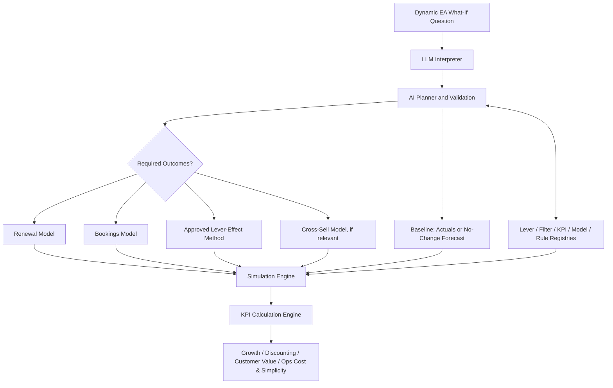

# Cisco EA What-If Modeling
## How One Trained Model Can Answer Multiple Business Questions

**Purpose:** Explain how a small library of trained predictive models can support many dynamic Cisco Enterprise Agreement (EA) what-if scenarios without training a separate model for every question.

**Audience:** Cisco / Tech Mahindra solution architects, data scientists, engineering team, and business stakeholders.

---

## 20 November 2026 update — four-lens, multi-target, scenario-scalable implementation

One model typically has one explicit prediction target; it may be reused across many questions with different **validated** feature/filter combinations. The Cisco proposal comprises (1) renewal propensity, (2) expansion/bookings, (3) **lever elasticity / causal response**, and (4) cross-sell later; Monte Carlo is **simulation, not a trained fifth model**. Initially prioritize 2–3 targets with complete labels and model acceptance gates.

**Supported question ≠ arbitrary new intervention:** an LLM can discover registered levers and filters but cannot create a validated causal response to a previously unseen term/discount intervention. A **Lever-to-KPI Dependency Registry** explicitly identifies whether a KPI impact comes from historical facts, approved formula, target model, causal evidence or a disclosed sensitivity assumption.

The latest proposed client deck moves from three to **four lenses**: Growth, Discounting, Customer Value, Ops Cost & Simplicity. Scenario outcomes feed a shared KPI layer and then these lenses; no margin calculations. Customer Value and Ops Cost data may be missing, and gaps must be visible.

**14 versus 37 scenarios:** measure coverage by unique targets, source tables, levers, formula operators, applicability regions and regression tests. Do not multiply model count by scenario count. Planning ranges discussed are ~10–14 versus ~16–24 elapsed weeks, conditional on actual complexity, staffing and Cisco data/SME readiness. The 11-Dec federal single-scenario demonstration is a separate, conditional checkpoint.

**Snowflake deployment:** approved SQL/Snowpark baseline + feature tables; CatBoost via ML Jobs/registry where enabled; advanced causal or Monte Carlo workloads in suitable compute/container runtimes; Cortex/LLM for typed routing and explanation; Streamlit as available. NVIDIA Kumo may be benchmarked as an alternative prediction provider but is not the selected production baseline.

## 1. Executive summary

A supervised machine-learning model usually predicts one **defined target** (for example, next-term bookings amount or renewal probability). It is *not* limited to answering one business question. The same trained model can receive many different valid combinations of inputs, customer filters, and scenario values, and return predictions for the same target.

Therefore:

> **One model per well-defined prediction task, where appropriate; many questions per model; multiple KPIs per scenario through approved calculations.**

Some ML architectures predict multiple targets, but separate, validated target-specific models are a practical starting point for the Cisco EA POC.

A prediction model can predict outcomes associated with input features; it does **not automatically identify the causal effect** of changing a contract term, price, or policy. Intervention claims require defensible causal evidence, a validated response model, or assumptions explicitly labeled as sensitivity analysis.

---

## 2. One target, many possible questions

Consider a trained **Future Bookings Model**.

| Property | Example |
|---|---|
| Prediction target | Future EA bookings amount over a specified horizon |
| Model family | CatBoost regressor |
| Population / grain | Defined contract, customer, or customer-suite records |
| Core features | Contract term, discount, customer segment, suite, tier, growth allowance, installed base, historical consumption |
| Output | Estimated bookings for the defined horizon and unit |

Illustrative feature contract:

```python
features = [
    "contract_term",
    "discount_percentage",
    "customer_segment",
    "suite",
    "tier",
    "growth_allowance",
    "installed_base",
    "historical_consumption",
]
target = "future_bookings"
```

The *same* model can be called for many questions:

| Business question | Filter(s) | Scenario feature change(s) | Prediction output |
|---|---|---|---|
| What if we offer 1-year instead of 3-year terms? | Eligible EA contracts | `contract_term: 3 -> 1` | Future bookings |
| What if discounts increase by 5 percentage points? | Relevant EA population | `discount_percentage: baseline -> baseline + 5pp` | Future bookings |
| What if growth allowance increases? | Eligible agreements | `growth_allowance` | Future bookings |
| What if 5-year terms are paired with higher discounts? | Selected customer cohorts | Term + discount | Future bookings |
| What if federal customers receive revised pricing? | `federal_flag = true` | Approved pricing lever(s) | Future bookings |

**Why this works:** The trained model represents a mapping from a *set of inputs* to the *same target*. A scenario changes the inputs, not the definition of the target. Retraining for each combination is unnecessary **when** the inputs, population, horizon, and scenario combinations are within the model's validated applicability.

**Important constraint:** A model that predicts bookings well on historical observations may still be unreliable at predicting the impact of a new policy. Changing the `discount_percentage` input and comparing two predictions produces a *model-based contrast*, not automatically a causal discount effect.

---

## 3. When one question needs several models

A dynamic scenario often affects several outcomes. For example:

> What if Cisco offers 1-year EA contracts instead of 3-year contracts, with an additional 5% discount?

This can affect renewal likelihood, future bookings, committed value, and operational workload. The system can invoke different reusable capabilities for each outcome:

| Capability | Target / function | Output consumed by |
|---|---|---|
| Renewal Propensity | Classification: probability of renewal | Renewal-rate and retained-customer KPIs |
| Bookings / Expansion | Regression: next-term bookings or expansion amount | Growth and financial KPIs |
| Lever Elasticity / Causal Response | Estimated impact of specified levers where identifiable | Scenario-response logic and sensitivity analysis |
| Cross-Sell | Classification: probability of buying another suite | Product-breadth / expansion KPIs |
| Deterministic Financial Operators | Approved pricing, commitment, NPV, or other formulas | KPI Calculation Engine |
| Monte Carlo Simulation | Propagate appropriate uncertainty across outcomes | P10/P50/P90 result distributions |

**Monte Carlo is a simulation technique, not a separately trained prediction model.** The engine selects only the capabilities required for the question; it does not automatically run every model.

### Example flow



The LLM chooses which approved analytical capabilities are relevant. The registries and validation layer determine what is permissible; models and approved calculation operators produce the numeric values.

---

## 4. KPIs do not each need a separate ML model

A KPI is not necessarily a prediction target. Many KPIs are deterministic transformations or aggregations of observed data and model outputs.

| KPI | Potential source |
|---|---|
| Renewal probability | Renewal propensity model |
| Future bookings | Bookings model |
| Cross-sell probability | Cross-sell model |
| Contracted commitments | Approved financial calculation on applicable data |
| Bookings change (%) | `(scenario_bookings - baseline_bookings) / baseline_bookings * 100`, if baseline nonzero |
| Discount level | Observed data plus the validated discount lever |
| Expected renewal events | Renewal probabilities / timing model plus contract schedule assumptions |
| Operational cost | Approved unit-cost assumptions or separate operational model, if available |

For example, **three trained predictive models can contribute to eight or more KPIs**, because the KPI engine also applies reusable business formulas, joins, aggregations, and baseline comparisons.

Formula ownership should be explicit: the **Simulation Engine** applies scenario changes and business transformations, while the **KPI Calculation Engine** applies standardized, versioned metric definitions and comparisons. Both should use consistent approved definitions.

---

## 5. Supporting 14 or 37 scenarios without 14 or 37 models

Scenario count is not the same as model count. A scenario may reuse existing targets, features, and simulation operators; another scenario may need a new data source, label, formula, or predictive capability.

| Scenario family | Reusable capabilities that may apply |
|---|---|
| Term flexibility | Renewal model, bookings model, term / commitment calculations |
| Discount changes | Bookings model, validated lever-response method, pricing rules |
| Growth allowance | Expansion/consumption capabilities, allowance calculations |
| Early renewal incentives | Renewal model, intervention-response estimate if available, incentive rules |
| Cross-sell | Cross-sell model and expansion / bookings calculation |
| True Forward | Approved True Forward calculation, possibly a consumption forecast |

A set of **14 scenarios could potentially reuse 2-3 models** with several operators. **37 scenarios could potentially reuse many of the same models**, but neither number can be guaranteed without inspecting each scenario's:

1. Prediction target and time horizon.
2. Required features, filters, grain, and historical data.
3. Business-rule and calculation requirements.
4. Lever-to-outcome causal assumptions.
5. Required KPI and lens outputs.
6. Validation and acceptance criteria.

**Timeline implication:** Estimate scope by *new analytical capabilities and dependencies*, not by `scenario_count x model_training_duration`.

---

## 6. How the AI planner chooses the right models

The system should use a **Model Registry** and **KPI Dependency Registry**, rather than asking the LLM to invent which equations or targets are available.

Example illustrative registry entry:

```yaml
model_id: renewal_propensity_v1
model_family: catboost_classifier
prediction_target: renewal_probability
prediction_horizon: next_eligible_renewal
input_grain: customer_agreement_suite_term
required_features:
  - contract_term
  - discount_percentage
  - customer_segment
  - suite
  - tier
supported_kpis:
  - expected_renewal_rate
  - expected_retained_customer_count
supported_input_levers:
  - contract_term
  - discount_percentage
validation_status: approved_for_defined_population
causal_effect_validated: false
```

This example registers *what the model predicts and accepts*. Listing a feature under `supported_input_levers` **does not mean its hypothetical change has a validated causal interpretation**.

### Query-to-execution sequence

1. **Interpret:** Parse the user question into filters, requested outcomes, levers, horizon, and comparator.
2. **Validate:** Check requested filters and lever values against governed registries and guidance-backed rules.
3. **Select:** Resolve each output KPI to approved predictive models and/or deterministic calculation operators.
4. **Baseline:** Compute observed historical metrics or an appropriate future no-change forecast using comparable scope and horizon.
5. **Simulate:** Apply approved scenario changes, invoke relevant models, and calculate supported scenario outcomes.
6. **Measure:** Calculate KPI deltas and, where valid, uncertainty intervals.
7. **Present:** Group results into the **four lenses shown in the current Cisco deck**: Growth, Discounting, Customer Value, Ops Cost & Simplicity.
8. **Explain:** Use the LLM and RAG to describe results, business definitions, assumptions, provenance, and limitations—not to invent figures.

---

## 7. Baseline and scenario comparison

A dynamic what-if result requires a suitable reference:

- **Historical baseline:** Compute actual metrics from relevant Snowflake records for an observed period.
- **Future no-change baseline:** Forecast future outcomes while retaining current terms, prices, and conditions.
- **Hybrid baseline:** Start with current contractual facts, then model future events such as renewals.

For future comparisons, run baseline and scenario over the **same cohort, horizon, accounting definitions, and relevant assumptions**, differing only in the specified interventions.

The KPI change can then be computed as:

\[
\Delta\% = \frac{KPI_{scenario} - KPI_{baseline}}{KPI_{baseline}} \times 100
\]

When the baseline is zero or not meaningful, use an alternative metric instead of a misleading percentage.

---

## 8. The distinction between predictive models and causal what-if estimates

This is a key limitation for Cisco's use case.

- **Predictive CatBoost model:** Learns relationships between historical features and an outcome. Useful for scoring contracts and forecasting under observed-like conditions.
- **Lever elasticity / causal-response model:** Attempts to estimate the effect of changing levers such as discounts or term lengths, subject to identification assumptions and available variation.
- **Deterministic business rule:** Implements an approved financial identity, eligibility rule, or accounting treatment; it does not require supervised ML.
- **Sensitivity assumption:** Explores a user-supplied or Finance-approved effect when the data cannot substantiate a causal estimate. Must be labeled as hypothetical.

For example, discounted contracts may historically renew less often because risky accounts receive greater discounts. A standard predictor might reproduce that association. It cannot alone establish that increasing discount *causes* lower renewal probability.

Also avoid **double-counting**: if a bookings model already incorporates the discount effect, the simulation must not apply a second elasticity adjustment unless the composition has been explicitly designed and validated.

---

## 9. Suggested first-phase model scope

Start with **2-3 models for which reliable targets, history, and features are available**:

| Priority | Candidate | Reason | Data-readiness gate |
|---|---|---|---|
| 1 | Renewal Propensity | Shared across term and renewal scenarios | Verified renewal label and full observation window |
| 2 | Bookings / Expansion | Powers growth and financial questions | Consistent target, forecast horizon, and accounting grain |
| 3 (conditional) | Lever Elasticity | Supports more defensible lever-response analysis | Sufficient treatment variation, overlap, and confounder coverage |

The third model may be deferred if causal identification is not feasible; a deterministic, clearly labeled sensitivity operator can still support an initial POC. Cross-sell can follow when historical suite-level acquisition labels are available.

**Deliverable for phase 1:** Demonstrate multiple distinct questions routing through the same interpreters, registries, validated models, simulation operators, and KPI engine without scenario-specific code branches.

### Suggested POC acceptance checks

- At least three materially different questions reuse the **same bookings model** with different filters/levers.
- At least one question invokes **more than one analytical capability**.
- UI controls are selected from registries, not fabricated by the LLM.
- Scenario and baseline use consistent metric definitions and time horizons.
- Unsupported or out-of-distribution interventions are rejected or clearly labeled as assumptions.
- Every numeric output traces to data, a versioned model, an approved calculation, or a documented assumption.
- Regression tests cover model selection, formula application, KPI aggregation, and lens presentation.

---

## 10. How this changes implementation planning

For estimates covering **14 versus 37 scenarios**, group work by reusable components:

| Workstream | Scaling driver |
|---|---|
| Data onboarding | Number and complexity of distinct sources / joins |
| Model training | Number of distinct targets and validated intervention models |
| Lever / Filter Registry | Unique controls, allowable values, cohort definitions |
| Rule / KPI Registry | Unique approved operators, definitions, and dependencies |
| AI planning | Distinct intent patterns and execution plans |
| Simulation | New effect mechanisms, conditional logic, uncertainty needs |
| QA | Distinct scenario families, boundary cases, reconciliation tests |

Scenario reuse reduces implementation effort, but broader coverage still increases data validation, governance, and testing. **Do not assume all 14 or all 37 scenarios are covered by the first 2-3 models.**

---

## 11. Core architectural takeaway

**Dynamic question -> LLM identifies intent -> Registry selects supported levers/filters/models/formulas -> Baseline + scenario execution -> KPI Engine -> Four business lenses -> LLM explanation.**

A model predicts a **defined target**, but that target can be requested from many different customer cohorts and hypothetical configurations. Multiple models and deterministic operators can be composed when a scenario needs several outcomes. The number of business questions therefore does not determine the number of models; **the required prediction tasks, data coverage, business calculations, and validated lever effects do.**

---

*Examples and identifiers in this document are architectural illustrations, not confirmation that any specific Cisco model, schema, lever policy, or causal effect has been approved.*

## Document alignment and decision status (20 November 2026)

**Latest deck baseline:** `Cisco_EA_WhatIf_Approach (1).pptx`, dated 19 November 2026, is the controlling **proposed client discussion narrative** for this revision. It specifies **four lenses**: **Growth, Discounting, Customer Value, and Ops Cost & Simplicity**. Earlier scope and architecture decks described **three lenses**; this is a revision that requires Cisco confirmation and consistent metric ownership.

**Evidence vs proposal:** The deck states the desired workflow and a draft calendar; it is not proof that all four lenses have usable data, causal lever-effect estimates, approved formulas, trained models, or production access. Items marked **Proposed** below are implementation recommendations. Items marked **Pending Cisco sign-off** are not established requirements. Its federal term-flexibility walkthrough contains illustrative directional impacts, not validated quantitative predictions.

**Other inputs:** `Cisco_EA_Architecture_Combined(2).pptx`; `Cisco_EA_Lever_Modelling_Scope_v4(2).pptx`; `EA Modeling Scenarios and Data Readiness(1).xlsx`; the 16-Nov term flexibility POC deck; manager's four-model + Monte Carlo suggestion; and the follow-up 14-/37-scenario planning discussion. The 14 and 37 counts are planning comparisons, not model counts or a promise of coverage. The 11-Dec-2026 federal demo is a *conditional proposed milestone*, not a promise of four fully measured lenses.
